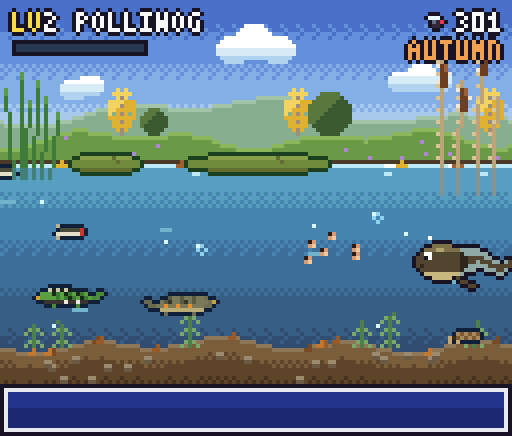

# 🐸 About Me:
Hi! I'm Alex, an ecologist (PhD) and data scientist (MSc).

  I’m interested in herpetology, freshwater ecology, and all data science-related. Currently working on new technologies for biodiversity monitoring.

  My personal website: www.alex-lopez-phd.vercel.app

  You can contact me on: 93lopez.alejandro@gmail.com

## My pond:

Grown from my GitHub contributions with [git-toad](https://github.com/Calotriton/git-toad).
